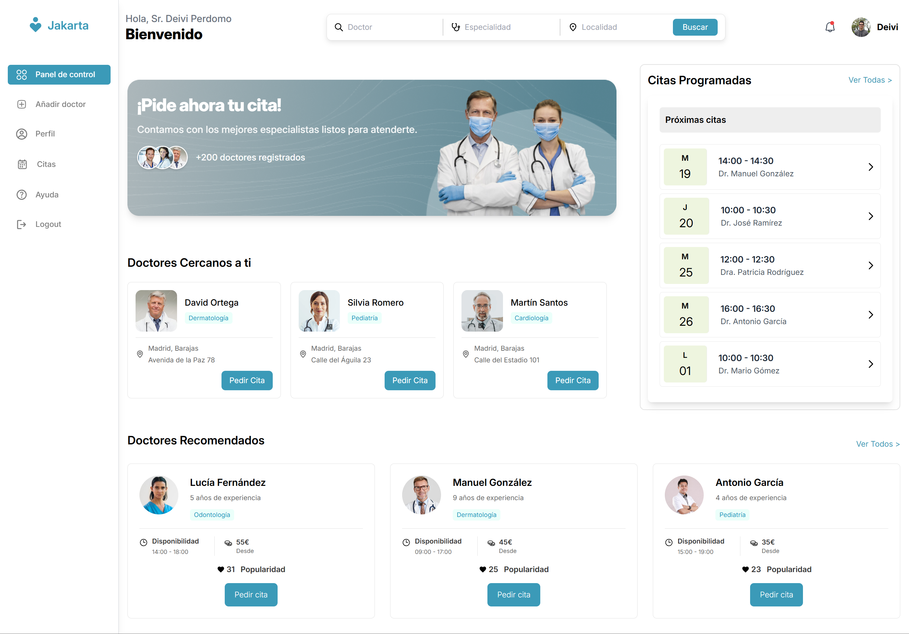
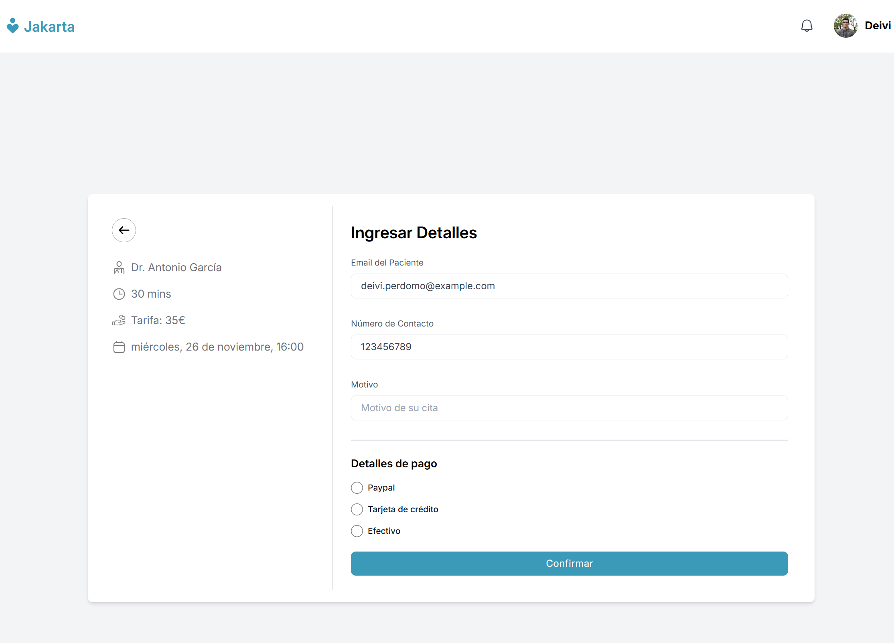
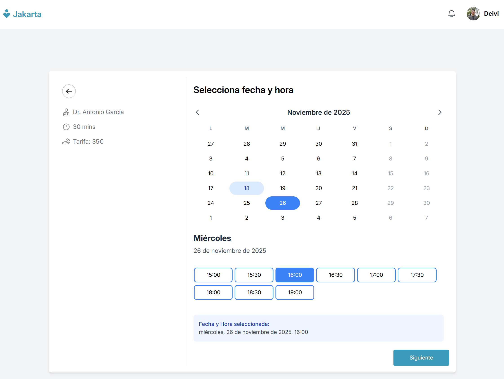
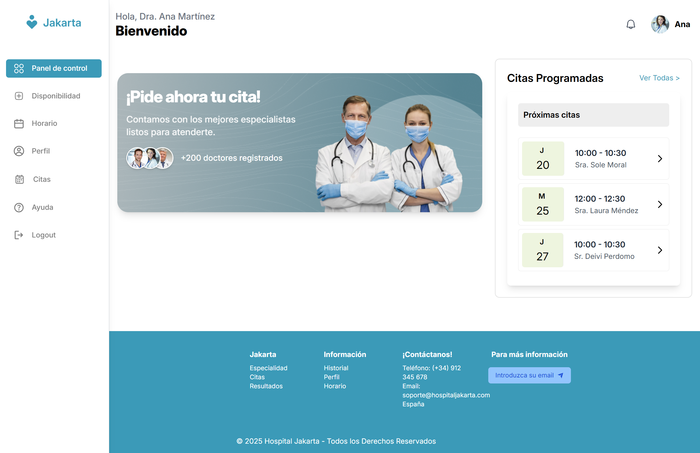
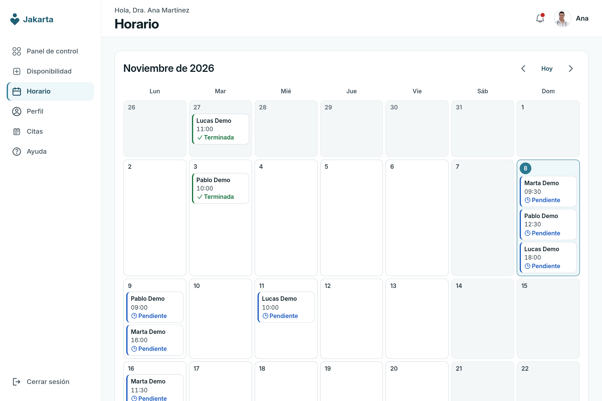
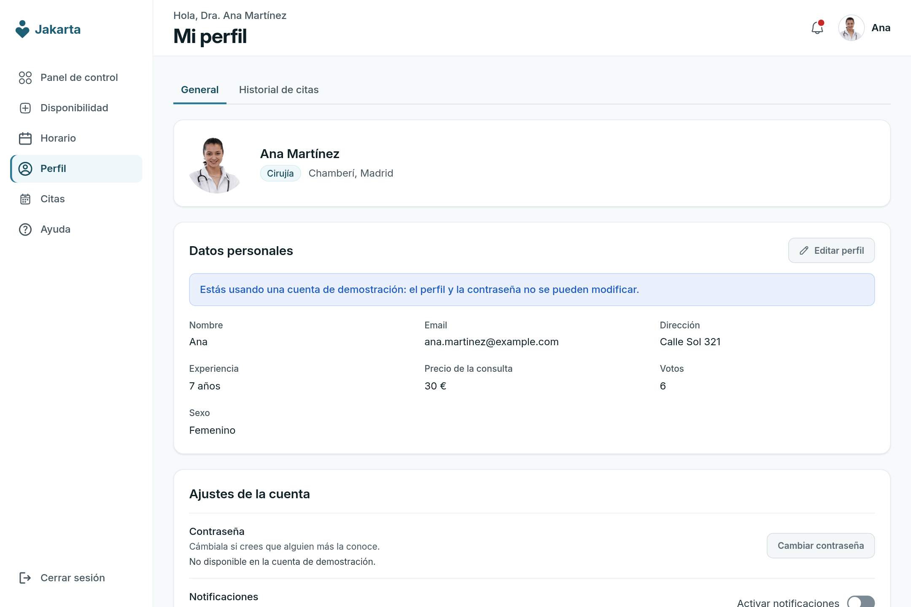

<div align="center">

# 🏥 Hospital Management System

### *Clínica Jakarta: citas médicas para pacientes y doctores*

**[🌐 Ver la demo en vivo](https://hospital-jakarta.deiviperdomo.dev)**



<br/>

    

</div>

---

## 📋 Descripción

Aplicación web para una clínica: los pacientes buscan doctores y reservan citas, y los doctores gestionan su agenda, sus informes y sus recetas.

## 🌐 Demo en vivo

Entra en **https://hospital-jakarta.deiviperdomo.dev** con una de estas cuentas. Las citas se regeneran cada noche, así que siempre hay datos al día.

| Rol | Usuario | Contraseña |
|-----|---------|------------|
| Paciente | `demo` | `demo1234` |
| Doctora (marcar «Soy Doctor») | `ana` | `ana` |

## ✨ Características Principales

| Funcionalidad | Descripción |
|--------------|-------------|
| 🔎 **Búsqueda de doctores** | Por especialidad y localidad, con doctores recomendados |
| 📅 **Reserva de citas** | Calendario con las horas libres de cada doctor, pago a elegir y cancelación con confirmación |
| 🗓️ **Agenda del doctor** | Citas de hoy, cita en curso, próximas citas, horario mensual y disponibilidad |
| 📄 **Informes y recetas** | El doctor registra diagnóstico, tratamiento y receta; el paciente los consulta en su historial |
| 🔔 **Notificaciones** | Avisos de citas para pacientes y de reservas nuevas para doctores |
| 🔒 **Seguridad** | JWT, contraseñas con BCrypt y permisos por rol y por recurso |
| ♿ **Accesibilidad** | Sin violaciones de axe (WCAG 2.2 AA) en las 14 rutas principales |
| 📱 **Responsive** | Diseño adaptado a móvil, tableta y escritorio |
| 🔌 **API REST** | Documentación Swagger/OpenAPI opcional, desactivada por defecto |

## 🛠️ Stack Tecnológico

<table>
<tr>
<td width="50%" valign="top">

### 🔧 Backend

```yaml
Lenguaje: Java 21
Framework: Spring Boot 3.4.2
Persistencia: Spring Data JPA
Base de Datos: PostgreSQL 16
Seguridad: Spring Security + JWT (HS256), BCrypt
Build Tool: Maven
Utilidades:
  - Lombok
  - OpenAPI/Swagger
```

</td>
<td width="50%" valign="top">

### 🎨 Frontend

```yaml
Framework: Angular 19
Lenguaje: TypeScript
Estilos: Tailwind CSS con tokens de diseño propios
Reactividad: RxJS
Build Tool: Angular CLI
Características:
  - Componentes standalone
  - Rutas con carga diferida
  - Diseño responsive
```

</td>
</tr>
</table>

## 📁 Estructura del Proyecto

```
hospital-app/
├── back/                    # Backend (Spring Boot)
│   ├── src/
│   │   ├── main/java/
│   │   ├── main/resources/bd/   # Esquema, datos de demo y migraciones
│   │   └── test/java/
│   ├── Dockerfile
│   ├── pom.xml
│   └── mvnw
├── front/                   # Frontend (Angular)
│   ├── src/app/
│   ├── public/              # Imágenes y estáticos
│   ├── Dockerfile
│   ├── nginx.conf
│   ├── package.json
│   └── angular.json
├── docker-compose.yml
├── .env.example
└── README.md
```

---

## 🚀 Instalación y Configuración

### 🐳 Producción con Docker Compose (recomendado)

Solo hace falta Docker con el plugin Compose. Las imágenes son multi-arch (funcionan en x86_64 y ARM64).

```bash
git clone https://github.com/deperdomo/hospital-app.git
cd hospital-app

# Secretos (no se suben al repo)
cp .env.example .env
sed -i "s|^POSTGRES_PASSWORD=.*|POSTGRES_PASSWORD=$(openssl rand -base64 32 | tr -d '/+=')|" .env
sed -i "s|^JWT_SECRET=.*|JWT_SECRET=$(openssl rand -base64 32)|" .env
chmod 600 .env

docker compose up -d --build
```

Se levantan tres contenedores en la red `hospital-net`:

| Servicio | Imagen | Puerto |
|----------|--------|--------|
| `hospital-db` | `postgres:16-alpine` (volumen `hospital-db-data`) | ninguno publicado |
| `hospital-back` | Spring Boot (Java 21), límite de 768 MB | ninguno publicado |
| `hospital-front` | nginx: sirve el SPA y hace proxy de `/api/` al backend | `127.0.0.1:8095` |

La primera vez (volumen vacío), Postgres ejecuta `back/src/main/resources/bd/hospital_jakarta_pg.sql`: crea el esquema, carga los datos de demo y hashea sus contraseñas con BCrypt.

**Redesplegar tras cambios:**
```bash
git pull && docker compose up -d --build
```

**Reiniciar la BD desde cero** (⚠️ borra todos los datos): `docker compose down -v && docker compose up -d --build`

**Backup manual:** `docker exec hospital-db pg_dump -U hospital hospital_jakarta > backup.sql`

> En el servidor, el acceso público va por Cloudflare Tunnel (`hospital-jakarta.deiviperdomo.dev` → `http://localhost:8095`).

---

### 💻 Desarrollo local

Requisitos: Java 21, Node.js 22 y Docker (para Postgres).

```bash
# 1. Postgres con el esquema y los datos de demo
docker run -d --name hospital-db-dev -p 127.0.0.1:5432:5432 \
  -e POSTGRES_DB=hospital_jakarta -e POSTGRES_USER=hospital -e POSTGRES_PASSWORD=hospital \
  -v "$PWD/back/src/main/resources/bd/hospital_jakarta_pg.sql:/docker-entrypoint-initdb.d/01.sql:ro" \
  postgres:16-alpine

# 2. Backend en http://localhost:8090 (Swagger en /swagger-ui.html)
cd back
DB_PASSWORD=hospital JWT_SECRET=un-secreto-de-al-menos-32-caracteres SWAGGER_ENABLED=true ./mvnw spring-boot:run

# 3. Frontend en http://localhost:4200 (proxy.conf.json redirige /api → localhost:8090)
cd ../front
npm install
npm start
```

Variables de entorno del backend:

| Variable | Por defecto | Descripción |
|----------|-------------|-------------|
| `DB_URL` | `jdbc:postgresql://localhost:5432/hospital_jakarta` | URL JDBC |
| `DB_USER` | `hospital` | Usuario de la BD |
| `DB_PASSWORD` | (vacío) | Contraseña de la BD |
| `JWT_SECRET` | **obligatoria** | Clave HMAC para firmar los JWT (mínimo 32 caracteres) |
| `SWAGGER_ENABLED` | `false` | Activa `/v3/api-docs` y Swagger UI |

---

## 🔐 Autenticación y API

El frontend llama siempre a `/api/...`; nginx (o el proxy de `ng serve`) quita el prefijo `/api` antes de pasar la petición al backend.

```http
POST /api/auth/login        {"username", "password", "tipo": "paciente" | "doctor"}
                            → {"token": "<JWT 8h>", "perfil": {...sin contraseña...}}
```

El resto de peticiones llevan `Authorization: Bearer <token>`. Sin token solo se puede acceder a:
`POST /auth/login`, `POST /usuario/alta` y los GET del catálogo (`/especialidad/all`, `/doctor/recomendado/*`, `/doctor/allDoctors`, `/doctor/localidad/*`, `/doctor/porNombreApellidoLocalidadYEspecialidad/**` y `/disponibilidad/doctor/*`).

- Un **paciente** solo ve y modifica sus propios datos, citas, recetas e historial.
- Un **doctor** ve sus citas y los datos de los pacientes con los que tiene citas.
- Un **admin** (usuario con `rol = admin`) puede dar de alta doctores (`POST /doctor/alta`).
- El alta pública siempre crea usuarios con `rol = paciente`.

### Cuentas de demostración

La página de login muestra las dos cuentas de la [demo en vivo](#-demo-en-vivo). `back/src/main/resources/bd/demo_reset.sql` recrea los pacientes de demo con citas **relativas a hoy** y restablece la contraseña y el horario de `ana`:

- `demo`: una cita hoy, cuatro próximas, cuatro terminadas con informe y receta, una cancelada y 2 notificaciones sin leer. Las citas que caerían en fin de semana se mueven al día laborable más cercano.
- La doctora `ana`: su agenda se llena además con dos pacientes de relleno (`marta.demo` y `pablo.demo`, sin contraseña conocida), con citas hoy, mañana y la semana que viene, informes de citas terminadas y 3 notificaciones de reservas nuevas sin leer.

Como las fechas se calculan desde la fecha del día, la demo nunca se queda sin citas futuras. El backend no permite cambiar la contraseña ni el perfil de estas dos cuentas, y la interfaz lo avisa antes de intentarlo. En el servidor, un cron lo ejecuta cada día:

```cron
30 3 * * * docker exec -i hospital-db psql -q -U hospital -d hospital_jakarta -v ON_ERROR_STOP=1 < /ruta/a/hospital-app/back/src/main/resources/bd/demo_reset.sql
```

**Migraciones:** si la base de datos se creó antes del 5/11/2026, aplica `back/src/main/resources/bd/migraciones/2026-11-05_visto_doctor.sql` (notificaciones de doctores). Las instalaciones nuevas ya la incluyen.

Otros usuarios de demo: paciente `carlos` / `password789`, doctora `ana` / `ana` y admin `deivi` / `deivi` (el resto está en el script SQL). Cámbialos si la instancia es pública.

---


## 🧪 Testing

```bash
cd back
./mvnw test
```

De momento el backend solo comprueba que el contexto de Spring arranca, y el frontend no tiene tests unitarios.

---

## 🤝 Contribución

Las contribuciones son bienvenidas. Por favor:

1. Fork el proyecto
2. Crea una rama feature (`git checkout -b feature/AmazingFeature`)
3. Commit tus cambios (`git commit -m 'Add some AmazingFeature'`)
4. Push a la rama (`git push origin feature/AmazingFeature`)
5. Abre un Pull Request

## 📝 Convenciones de Código

### Backend
- Uso de **Lombok** para reducir boilerplate
- Nomenclatura en español para entidades y servicios
- Comprobaciones de acceso centralizadas en `Acceso`

### Frontend
- Seguir **Angular Style Guide**
- Uso de **TypeScript** estricto
- Componentes standalone y reutilizables
- Estilos con **Tailwind CSS** y las clases base de `styles.css`

## 🐛 Problemas Conocidos

- Las notificaciones se actualizan al cargar la página, no en tiempo real
- Los listados no tienen paginación
- La cobertura de tests es mínima

## 📄 Licencia

Este proyecto está bajo la Licencia MIT.

---

## 👨‍💻 Autores

<table>
  <tr>
    <td align="center">
      <a href="https://github.com/smoral1">
        <br />
        <sub><b>@smoral1</b></sub>
      </a>
    </td>
    <td align="center">
      <a href="https://github.com/DiegoMartzG">
        <br />
        <sub><b>@DiegoMartzG</b></sub>
      </a>
    </td>
    <td align="center">
      <a href="https://github.com/deperdomo">
        <br />
        <sub><b>@deperdomo</b></sub>
      </a>
    </td>
  </tr>
</table>  


## 🆘 Soporte

Si tienes alguna pregunta o problema, por favor:

1. Revisa los [Issues existentes](https://github.com/deperdomo/hospital-app/issues)
2. Crea un [nuevo Issue](https://github.com/deperdomo/hospital-app/issues/new) si es necesario
3. Incluye detalles del problema y pasos para reproducirlo

---

## 📸 Capturas de Pantalla

### 👤 Panel de Usuario

<table>
  <tr>
    <td align="center">
      
      <br />
      <sub><b>Panel del paciente</b></sub>
    </td>
    <td align="center">
      
      <br />
      <sub><b>Reservar cita</b></sub>
    </td>
  </tr>
  <tr>
    <td align="center" colspan="2">
      
      <br />
      <sub><b>Mis citas</b></sub>
    </td>
  </tr>
</table>

### 👨‍⚕️ Panel de Doctor

<table>
  <tr>
    <td align="center">
      
      <br />
      <sub><b>Agenda de hoy</b></sub>
    </td>
    <td align="center">
      
      <br />
      <sub><b>Horario del mes</b></sub>
    </td>
  </tr>
  <tr>
    <td align="center" colspan="2">
      
      <br />
      <sub><b>Perfil del doctor</b></sub>
    </td>
  </tr>
</table>


---

<div align="center">

### ⭐ Si este proyecto te ha sido útil, ¡no olvides darle una estrella!

**Hecho con ❤️ por el equipo de Hospital Management System**

[⬆ Volver arriba](#-hospital-management-system)

</div>
